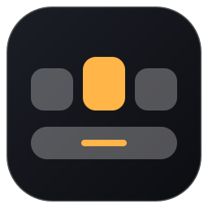

<div align="center">



# WinDock

**One Windows PC. Several environments.**<br>
A floating dock with presets that switch by time of day: work apps from 9 to 6, games after hours, one click or one hotkey to change.

[](https://github.com/obrenoalvim/windock/releases/latest/download/WinDock-win-x64.zip)

[](LICENSE)
[](https://github.com/obrenoalvim/windock/stargazers)
[](src/WinDock/WinDock.csproj)
[](#faq)

**English** · [Português](README.pt-BR.md)

[Features](#features) · [Presets](#presets) · [Hotkeys](#hotkeys) · [Build](#build) · [FAQ](#faq)

</div>

---

WinDock is a small WPF app that puts a dock on your screen and swaps its contents by **preset**. A preset is a JSON file with the apps you want in that context, an accent color, a few widgets and, optionally, a schedule. At 9:00 on a weekday the dock becomes your work dock; at 18:00 it becomes your games dock. It does not replace the Windows taskbar, it sits next to it.

Inspired by [PrimoDock](https://dock.oprimo.dev/) for macOS.

## Features

- **Presets with a schedule.** Days and time ranges per preset, switched automatically. A manual pick lasts until the next scheduled change.
- **Real icons.** Taken from each program, including Steam, Epic and other URI launchers.
- **Running indicator.** A dot under every app that is open.
- **Widgets.** Clock, CPU, RAM and "next switch" (what the dock becomes and when).
- **Drag and drop.** Drop an `.exe` or shortcut on the dock to pin it to the current preset. Right-click a tile to remove it.
- **Tray icon.** Preset list, auto-switch toggle, auto-hide, notifications, start with Windows.
- **Safe by default.** Switching never closes anything and never launches anything unless the preset sets `launchOnActivate`.
- **Hand-editable.** Presets live in `%APPDATA%\WinDock\presets`. Reload from the tray, no restart.

## Presets

Four starters are installed on first run: **Trabalho** (Mon-Fri 09:00-18:00), **Jogos** (Mon-Fri 18:00-09:00), **Estudos** (manual) and **Fim de semana** (Sat-Sun). Apps that are not installed on your machine are hidden automatically.

```json
{
  "id": "trabalho",
  "name": "Trabalho",
  "glyph": "💼",
  "accent": "#FFB547",
  "launchOnActivate": false,
  "schedule": [{ "days": "Mon-Fri", "start": "09:00", "end": "18:00" }],
  "widgets": ["next", "cpu", "ram", "clock"],
  "items": [
    { "name": "VS Code", "target": "%LOCALAPPDATA%\\Programs\\Microsoft VS Code\\Code.exe", "process": "Code" },
    { "name": "Steam", "target": "steam://open/main", "icon": "C:\\Program Files (x86)\\Steam\\steam.exe", "process": "steam" }
  ]
}
```

| Field | Meaning |
|---|---|
| `schedule[].days` | `Mon-Fri`, `Sat,Sun`, `Fri-Mon`. The first preset (by file name) that matches wins. |
| `schedule[].start` / `end` | `HH:mm`, end is exclusive, `24:00` means midnight. For 18:00 to 09:00, use two slots (`18:00-24:00` and `00:00-09:00`). |
| `items[].target` | Executable, shortcut, folder or URI (`steam://...`). Environment variables and `PATH` lookups work. |
| `items[].icon` | Optional. Path to an image or exe used for the icon. If it does not exist, the item is hidden. |
| `items[].process` | Optional. Process name for the running dot, when it differs from the exe name. |
| `launchOnActivate` | Launch every item when the schedule activates this preset. Off by default. |
| `widgets` | Any of `clock`, `cpu`, `ram`, `next`. |

File names set the order (`01-`, `02-`...), which is also the `Ctrl+Alt+N` number.

## Hotkeys

| Keys | Action |
|---|---|
| `Ctrl+Alt+Space` | Show or hide the dock |
| `Ctrl+Alt+1` ... `9` | Switch to the Nth preset |

## Build

Needs the [.NET 10 SDK](https://dotnet.microsoft.com/download) on Windows.

```powershell
dotnet run --project src/WinDock
dotnet test
dotnet publish src/WinDock -c Release -r win-x64 --self-contained false -p:PublishSingleFile=true
```

Layout: `Models/` (presets, schedule), `Services/` (schedule resolver, launcher, icons, tray, stats), `ViewModels/` (MVVM Toolkit), `Views/` and `Themes/` (XAML).

## FAQ

**Does it hide or replace the Windows taskbar?** No. It is a floating window, so there is nothing to break when Windows updates.

**Does it close my work apps at 18:00?** No. Closing programs can lose unsaved work. The dock only changes what it shows.

**Why is an app missing from a preset?** Its path was not found on this machine. Fix the `target` in the JSON or drop the correct `.exe` on the dock.

**Does it isolate windows per environment like virtual desktops?** Not yet.

## License

[MIT](LICENSE). Bundled fonts (Michroma, Space Mono) are under the SIL Open Font License.
